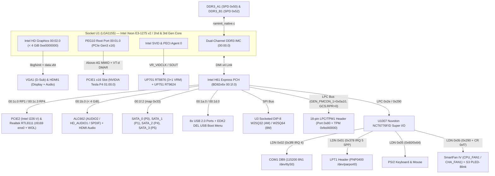

# ASRock H61M-S1 PLUS — Coreboot + EDK2 UEFI Port


%20%7C%20W25Q64%20(8M)-d97706?style=flat-square)


**Quick Navigation:**
[**Releases**](../../releases) ·
[**Features Catalog**](docs/COREBOOT-FEATURES-CATALOG.md) ·
[**Supported CPUs**](docs/SUPPORTED-CPUS.md) ·
[**Hardware Map**](docs/HARDWARE-MAP.md) ·
[**Porting & Lessons**](docs/PORTING-AND-LESSONS-LEARNED.md) ·
[**Hardware Report**](docs/HARDWARE-REPORT.md) ·
[**Blobs & Licenses**](BLOBS.md) ·
[**OS Configurator (`h61_coreboot_config.py`)**](scripts/h61_coreboot_config.py) ·
[**Agent Skills**](.agents/skills/)

Open-source **Coreboot + EDK2 `UefiPayloadPkg`** board port, Sandy/Ivy Bridge chipset patches, **`Delete`-key USB Boot Menu** ([`patches/0002-edk2-delete-key-usb-boot-menu.patch`](patches/0002-edk2-delete-key-usb-boot-menu.patch)), **GRUB `fwsetup` CF9 auto-reset fix & full Secure Boot + NVMe DXE support** ([`patches/0003-edk2-cf9-reset-and-secureboot-components.patch`](patches/0003-edk2-cf9-reset-and-secureboot-components.patch)), Linux OS runtime TUI/CLI configurator ([`scripts/h61_coreboot_config.py`](scripts/h61_coreboot_config.py)), ready-to-flash **4 MiB (`W25Q32`) & 8 MiB (`W25Q64`)** ROMs with committed IFD/ME/VBT blobs ([`blobs/`](blobs/)), comprehensive documentation, AI agent skills ([`.agents/skills/`](.agents/skills/)), and automated CI release pipeline ([`quarterly-release.yml`](.github/workflows/quarterly-release.yml)) for the **ASRock H61M-S1 PLUS** motherboard (`H61M-VS4 G/A 1.00`, LGA1155, Intel H61 Express `8086:1c5c`, Nuvoton `NCT6776F/D` Super I/O, Realtek `ALC662`, Realtek `RTL8111`, `W25Q32` / `W25Q64` SPI flash).

### Highlights New in `v26.11.4`
- **Automatic Reset into UEFI Setup from GRUB `fwsetup` (`"UEFI Firmware Settings"`)**: Fixed `UefiPayloadPkg/Library/ResetSystemLib/ResetSystemLib.c` ([`0003`](patches/0003-edk2-cf9-reset-and-secureboot-components.patch)) so cold/warm `0xcf9` reset writes `0x02 -> 0x06` (`LEGACY_RESET_SYSTEM` -> `LEGACY_RESET_CPU | LEGACY_RESET_SYSTEM`) instead of `0x0a -> 0x0e` (`LEGACY_RESET_FULL`), which previously dropped `SLP_S5#` into shutdown when `power_on_after_fail=S5`. **Live-verified on `h61` via Ubuntu Server USB GRUB -> `UEFI Firmware Settings` -> automatic cold reset into `UiApp`!**
- **Complete UEFI Secure Boot DXE Stack (Pre-Enrolled & Disabled by Default)**: Added `Pkcs7VerifyDxe`, `RngDxe`, and `Hash2DxeCrypto` alongside `SecureBootConfigDxe`, `EnrollDefaultKeys`, `SecurityStubDxe`, and `DxeImageVerificationLib` (`CONFIG_EDK2_SECURE_BOOT_SUPPORT=y`). Pre-enrolls Microsoft 2011+2023 `PK`/`KEK`/`db`/`dbx` keys in `UserMode` (`PK=1575B KEK=3066B db=7636B dbx=21416B`) while defaulting Secure Boot to **Disabled** (`System Configuration` -> `Secure Boot Configuration`) so unsigned kernel modules (such as Tesla P4 `nvidia.ko`) work out of the box and Secure Boot can be toggled ON anytime.
- **Explicit NVMe PCIe Boot Driver (`-D NVME_ENABLE=TRUE`)**: Explicitly enabled `NVME_ENABLE=TRUE` across all 4 build defconfigs (`NvmExpressDxe` verified in `UEFIPAYLOAD.txt`) and added NVMe + Secure Boot status reporting to `h61-coreboot-config` (`self-test` / `status` / TUI).
- **Carried Forward & USB Stick Live-Verified (`v26.11.3` Features)**: Tapping **`Delete`** (`\x1b[3~`, `0x7f`, `ESC[X`) opens **`Select USB Boot Device:`** — now live-verified on `h61` with an Ubuntu Server USB stick (`USB Device` listed -> booted into GRUB!), alongside **`LPT1` (`0x378`)**, **`LPC/TPM1` Port `0x80` + TPM 1.2 probe**, and **4 public `W25Q32`/`W25Q64` ROM variants with blobs**.

---

## Table of Contents

1. [Disclaimers & Known Caveats](#1-disclaimers--known-caveats)
2. [Documentation Index](#2-documentation-index)
3. [Software-to-Hardware Connection Map](#3-software-to-hardware-connection-map)
4. [Ready-to-Flash ROM Variants (`v26.11.4`, Blobs Included)](#4-ready-to-flash-rom-variants-v26114-blobs-included)
5. [Verified Hardware Status (`v26.11.4`)](#5-verified-hardware-status-v26114)
6. [Configuring Coreboot from Linux TUI/CLI or UEFI Setup](#6-configuring-coreboot-from-linux-tuicli-or-uefi-setup)
7. [Building & Flashing Guide](#7-building--flashing-guide)
8. [Repository Layout](#8-repository-layout)

---

## 1. Disclaimers & Known Caveats

> [!CAUTION]
> **Hardware Risk & Recovery**: Flashing motherboard SPI firmware can permanently brick hardware if interrupted or misconfigured. This project is provided **AS IS** with **NO WARRANTY**. Always capture and verify two independent full-chip stock backups with an external SPI flash programmer before writing any ROM. Only flash ROMs matching your physical chip size (`4 MiB` `W25Q32` vs `8 MiB` `W25Q64`).

> [!WARNING]
> **Known Caveats (`v26.11.4`)**:
> - **Internal vs External SPI Flashing for Minimal ME**: If your board currently boots with a stock vendor-locked IFD (`FREG2` locked internally, `0x001000–0x17ffff`), `flashrom -p internal` can ONLY update `FREG1` (`0x180000+`) using `*-w25q64-8mb-mecleaned-compat-full.rom` (`8 MiB`) or `*-w25q32-4mb-stock-me-full.rom` (`4 MiB`). To switch to the **`124 KiB` minimal-ME (`AltMeDisable=1`) + `FLMSTR1=0xffff0000` unlocked** layout (`w25q64-8mb-minimal-me-full.rom` / `w25q32-4mb-minimal-me-full.rom`), pull socketed DIP-8 `U3` and flash once with an external SPI programmer (unlocking full-chip internal `flashrom` writes permanently afterward).
> - **Cougar Point H61 ME Requirement & `me_state`**: H61 (`Cougar Point`) hardware enforces a 30-minute power-off timer if `FTPR` (`ROMP` + `BUP`) is absent from ME; thus `me_cleaner -S -r -t -d` (`124 KiB` `FTPR` + `AltMeDisable=1`) is the minimum hardware-safe ME. Also leave runtime CFR `me_state=0` (`Normal`) when running locked stock `FREG2` ME `8.1.20.1336` (Coreboot's `me_smm.c` already hides `00:16.0` from Linux before OS handoff, whereas `me_state=1` triggers a harmless ~1.3s `ME_GEN_7` MKHI timeout warning).
> - **Secure Boot Default State**: Default Microsoft keys are pre-enrolled (`UserMode`) and Secure Boot enforcement is **Disabled by default** (`# CONFIG_EDK2_SECURE_BOOT_DEFAULT_ENABLE is not set`) so unsigned out-of-tree modules (e.g., Tesla P4 `nvidia.ko`) continue to load cleanly. Toggle **`Attempt Secure Boot`** under `System Configuration` -> `Secure Boot Configuration` if you only boot signed kernels/MOKs.
> - **Untested Edge Hardware (`v26.11.4`)**: Single USB stick `Delete` menu (`USB Device`), GRUB `fwsetup` auto-reset into `UiApp`, and `Secure Boot Configuration` are now live-verified on hardware. Physical `VGA1` D-Sub monitor, physical LPC POST card, discrete LPC TPM 1.2 module, physical PCIe/M.2 NVMe SSD (`NvmExpressDxe` verified in `UEFIPAYLOAD.txt` only), simultaneous multi-USB-stick (`>=2`) selection, `1600 MT/s` / `1.65 V` XMP DIMMs, and `2x8` bifurcation risers remain untested directly on hardware.
> - **ACPI S3 with NVIDIA Proprietary / vGPU Driver (`NVreg_PreserveVideoMemoryAllocations=1`)**: Linux requires writing `suspend` to `/proc/driver/nvidia/suspend` before sleeping (and `resume` afterward); [`scripts/h61_coreboot_config.py`](scripts/h61_coreboot_config.py) (`s3` command & TUI) performs this handshake automatically.
> - **PCIe x16 Slot Bifurcation (`2x8` / `1x8+2x4`)**: Exposed in runtime CFR (`peg_bifurcation`); on Ivy Bridge LGA1155, splitting lanes also requires CPU `CFG[6:5]` physical hardware straps; only `1x16` (`PCIE1`) is tested on hardware.

> [!NOTE]
> **LLM / AI-Assisted Engineering Disclaimer**: Portions of the board port source files, chipset/EDK2 patches, Python TUI/CLI configurator, skill workflows, and documentation were authored or refined with **Large Language Model (LLM)** assistance under human supervision, and cross-checked against the ASRock `H61M-VS4 G/A 1.00` boardview, Intel/Nuvoton/Realtek/Winbond datasheets, stock SPI dumps, and live physical hardware telemetry.

---

## 2. Documentation Index

| Document | Contents |
|---|---|
| [**`docs/COREBOOT-FEATURES-CATALOG.md`**](docs/COREBOOT-FEATURES-CATALOG.md) | Exhaustive tables of **all** Coreboot software & hardware features (`v26.11.4` Delete-key USB Boot Menu, `fwsetup` auto-reset, Secure Boot + NVMe DXE, `LPT1`, `LPC/TPM1`, `CFR`, `libgfxinit`, `NRI`, SmartFan IV, `W25Q32`/`W25Q64` ME variants) |
| [**`docs/SUPPORTED-CPUS.md`**](docs/SUPPORTED-CPUS.md) | Complete **Supported LGA1155 CPUs** list (Xeon E3-1200 v1/v2, Core i7/i5/i3 2xxx/3xxx, Pentium, Celeron, `UP701` `RT8876` 95 W VRM ceiling, IGD/VT-d/PCIe 3.0 caveats) |
| [**`docs/HARDWARE-MAP.md`**](docs/HARDWARE-MAP.md) | Full **Software-to-Hardware Connection Map** (CPU `U1` PEG/CFG pins, PCH GPIOs `0..75`, `NCT6776F` LDNs & pin-mux, VRM rails, 4-variant SPI flash layouts) |
| [**`docs/PORTING-AND-LESSONS-LEARNED.md`**](docs/PORTING-AND-LESSONS-LEARNED.md) | Accumulated platform engineering knowledge (Above-4G 32-bit clamp, `TerminalConIn.c` `PcAnsi` VT220 `Delete` decode, `BootManagerMenuApp` USB match, CF9 `0x02/0x06` `fwsetup` reset fix, `me_cleaner` `124 KiB` alignment, `ME_GEN_7` vs ME `8.1.20`) |
| [**`docs/HARDWARE-REPORT.md`**](docs/HARDWARE-REPORT.md) | Live hardware bring-up telemetry, `flashrom` verification logs, `COM5` Delete-key & USB `fwsetup` auto-reset proof, Secure Boot UI capture, and `v26.11.4` release checksums |
| [**`BLOBS.md`**](BLOBS.md) & [**`LICENSES/`**](LICENSES/) | Complete inventory & SHA-256 hashes of all 8 committed blobs (`blobs/`) + open-source/proprietary licenses |
| [**`.agents/skills/`**](.agents/skills/) | Reusable AI agent workflows (`coreboot-build-and-flash`, `edk2-usb-boot-and-me-variants`, `h61m-s1-plus-linux-bringup`, `serial-communication`, `bios-image-inspection`) |

---

## 3. Software-to-Hardware Connection Map

### Mermaid Architecture Diagram



---

## 4. Ready-to-Flash ROM Variants (`v26.11.4`, Blobs Included)

All 4 full ROM images are published under [**Releases (`v26.11.4`)**](../../releases/tag/v26.11.4), built from reproducible defconfigs in [`configs/`](configs/) with [`blobs/`](blobs/) (`IFD` with `FLMSTR1=0xffff0000`, `ME`, and desktop `data.vbt`), and verified with `ifdtool -d`, `me_cleaner.py -c` (`FTPR` RSA VALID), and `cbfstool`:

| Release Artifact (`*-full.rom`) | Flash Chip | Intel ME (`0x001000+`) | `AltMeDisable` | BIOS Offset / Size | CBFS Free Space | SHA-256 | Flash Notes |
|---|---|---|---:|---|---:|---|---|
| **`h61m-s1-plus-coreboot-v26.11.4-w25q64-8mb-minimal-me-full.rom`** | `W25Q64` (`8 MiB`) | `124 KiB` (`me_cleaner -S -r -t -d`) | **Yes (`1`)** | `0x020000` (`7.875 MiB`) | `5,850,532` B | `737110f472874d382a9b5b561da9399f76ed45903d10f86d43151903da2d2441` | **Recommended (`8 MiB`)**: Flash once externally on `U3` (permanently unlocks IFD for future internal updates!) |
| **`h61m-s1-plus-coreboot-v26.11.4-w25q64-8mb-mecleaned-compat-full.rom`** | `W25Q64` (`8 MiB`) | `1532 KiB` (`me_cleaner -S -d`) | Yes (`1`, IFD) | `0x180000` (`6.5 MiB`) | `4,408,676` B | `d32818a115ad1c99a47c80dc7f7711c6c57cc30cbbf3ce9f78a1db578e7f7882` | **Live Hardware-Verified (`8 MiB`)**: Compatible with `flashrom -p internal --ifd -i bios` on locked stock IFD |
| **`h61m-s1-plus-coreboot-v26.11.4-w25q32-4mb-minimal-me-full.rom`** | `W25Q32` (`4 MiB`) | `124 KiB` (`me_cleaner -S -r -t -d`) | **Yes (`1`)** | `0x020000` (`3.875 MiB`) | `1,656,228` B | `dc77fad456aaded59497566b49b12726bf4cacf62a74523a941fd901c27c1455` | **Recommended (`4 MiB`)**: Flash once externally on `U3` to reclaim `3.875 MiB` BIOS + minimal ME |
| **`h61m-s1-plus-coreboot-v26.11.4-w25q32-4mb-stock-me-full.rom`** | `W25Q32` (`4 MiB`) | Stock `8.1.20.1336` (`1532 KiB`) | No (`0`) | `0x180000` (`2.5 MiB`) | `214,372` B | `4a0f5596e0fd237bea29a18241dd9d977407591610199904a9bd1d8ba871bac7` | Internal `flashrom --ifd -i bios` compatible on stock `4 MiB` `W25Q32` |

---

## 5. Verified Hardware Status (`v26.11.4`)

Tested via internal `flashrom -p internal -c "W25Q64BV/W25Q64CV/W25Q64FV" --ifd -i bios --noverify-all` (`w25q64-8mb-mecleaned-compat-full.rom`) on physical ASRock H61M-S1 PLUS (`Intel Xeon E3-1275 v2`, 2× 8 GB DDR3, NVIDIA Tesla P4 in `PCIE1`, Intel I226-V in `PCIE2`, Ubuntu 26.04 `7.0.0-43-generic`):

| Subsystem | Observed Hardware Result (`v26.11.4`) |
|---|---|
| **SPI Flash (`W25Q64`)** | `SF: Detected ef 4017` (`8 MiB`), `RW_MRC_CACHE` (`64 KiB`), `SMMSTORE` (`256 KiB` EFI FV), `COREBOOT` (`6.5 MiB` / `4,408,676` B free, `fallback/payload` `1,700,717` B); `VERIFIED` internal flash (`FLASH_EXIT_CODE: 0`) |
| **`Delete`-Key USB Boot Menu & GRUB `fwsetup` Reset** | Live-verified via `COM5`: tapping **`Delete`** (`\x1b[3~`) opened **`Select USB Boot Device:`** listing Ubuntu Server USB (`USB Device`) -> booted `GNU GRUB version 2.14` -> selecting **`UEFI Firmware Settings`** (`fwsetup`) triggered an **immediate automatic cold reset** (`CF9 0x02/0x06`, second Coreboot bootblock/ramstage) straight into **`UiApp`** with zero shutdown |
| **UEFI Secure Boot & NVMe DXE** | `System Configuration` -> `Secure Boot Configuration` live-verified (`Current Secure Boot State: Disabled`, `Secure Boot Keys: Default`, `Standard Mode`); `h61-coreboot-config`: `UEFI Secure Boot: Disabled (UserMode, keys_enrolled=True, PK=1575B KEK=3066B db=7636B dbx=21416B)`; `NvmExpressDxe`, `Pkcs7VerifyDxe`, `RngDxe`, `Hash2DxeCrypto`, `EnrollDefaultKeys`, `SecureBootConfigDxe` verified in `UEFIPAYLOAD.txt` |
| **Serial & Parallel (`NCT6776F`)** | **`COM1`** (`0x3f8` IRQ 4, `PNP0501`) `115200 8N1` + **`LPT1`** (`0x378` IRQ 5 DRQ 4 SPP `CRf0=0x38`, `PNP0400`, `/dev/parport0`) **both active** (`COM1=True`, `LPT1=True` in `self-test`); `nct6776` SmartFan IV live (`fan1=4736 RPM`, `fan2=1753 RPM`) |
| **`LPC/TPM1` Port `0x80` & TPM Probe** | `LPC: GEN_PMCON_1=0x0a10 RCBA_GCS=0x00000c21 LPC_EN=0x3c0f LPC_IO_DEC=0x0010` (`RPR_Port80_PCI=0`, 33 MHz `CLK_PCH_PORT80` active), Coreboot + EDK2 (`0xE1..0xE8`) Port `0x80` POST; `pc80_tpm_probe: No TPM device found` |
| **OS Runtime CFR (`efivarfs`)** | All **10 CFR options** (including `me_state`) exposed in `efivars` (`0x00000007 present=True`), `sudo h61-coreboot-config self-test` -> **`RESULT: PASS`** |
| **Intel ME Visibility in OS** | Coreboot `me_smm.c` (`RCBA32_OR(FD2, PCH_DISABLE_MEI1)`) hides PCI `00:16.0` before OS handoff (`lspci -s 00:16.0` empty!) |
| **Memory, IGD, GPU, LAN, S3** | `16 GiB` dual-channel DDR3 `1332 MT/s CL9`; `00:02.0` (`<4G`) `libgfxinit` + `vbt.bin` **zero `i915` forcewake warnings** (`I915_CLEAN`); `01:00.0` `Tesla P4` `nvidia-smi -L` active even with Secure Boot keys enrolled; `I226-V` + `RTL8111` (`eno0`) active |

---

## 6. Configuring Coreboot from Linux TUI/CLI or UEFI Setup

> [!TIP]
> Configure all **10 Coreboot BIOS options** directly from Linux (headlessly over SSH or `COM1`) using [`scripts/h61_coreboot_config.py`](scripts/h61_coreboot_config.py), or at boot via **`ESC`** (Setup Option Menu) / **`Delete`** (`Select USB Boot Device:`):

```bash
sudo install -m 0755 scripts/h61_coreboot_config.py /usr/local/bin/h61-coreboot-config

sudo h61-coreboot-config                   # Interactive 4-tab curses TUI
sudo h61-coreboot-config self-test         # Verify 10 CFR efivars, COM1, LPT1, WOL, hwmon
sudo h61-coreboot-config status            # Live system telemetry
sudo h61-coreboot-config list              # List all 10 CFR options
sudo h61-coreboot-config set fan_profile quiet
sudo h61-coreboot-config s3 --seconds 15   # Safe S3 suspend with NVIDIA procfs handshake
sudo h61-coreboot-config flash <full.rom>  # Safe internal 4M/8M '--ifd -i bios' flash
```

---

## 7. Building & Flashing Guide

### Option 1: Flash Pre-Built Public Release ROMs (`blobs/` Included)
Download your target variant from [**Releases (`v26.11.4`)**](../../releases/tag/v26.11.4) and verify `SHA256SUMS.txt`:
- **External SPI Programmer (Recommended once on socketed `U3`)**: Flash `h61m-s1-plus-coreboot-v26.11.4-w25q64-8mb-minimal-me-full.rom` (`W25Q64`) or `...-w25q32-4mb-minimal-me-full.rom` (`W25Q32`). Unlocks `FLMSTR1=0xffff0000` for future internal updates and activates `124 KiB` minimal ME + `AltMeDisable=1`.
- **Internal `flashrom` from Linux (`FREG2` still vendor-locked)**:
  ```bash
  sudo flashrom -p internal -c "W25Q64BV/W25Q64CV/W25Q64FV" --ifd -i bios --noverify-all \
    -w h61m-s1-plus-coreboot-v26.11.4-w25q64-8mb-mecleaned-compat-full.rom
  ```

### Option 2: Build All 4 Variants From Source
Inside `coreboot/coreboot-sdk:latest` (or Ada-enabled Coreboot toolchain with `gnat`):

```bash
git clone https://github.com/coreboot/coreboot.git
cd coreboot && git checkout df45ea2c49b4c7f6a1d2a969934cf6c6a2cb9018
cd ..
COREBOOT_DIR="$PWD/coreboot" RELEASE_TAG="v26.11.4" bash scripts/build_all_roms.sh
```

*(Or assemble custom stock dumps using [`scripts/assemble_full_rom.sh`](scripts/assemble_full_rom.sh) with `--stock-dump`, `--bios-region`, `--bios-offset`, `--rom-size`, `--vbt`, `--me-cleaner`.)*

---

## 8. Repository Layout

```text
.
├── .agents/skills/                         # AI agent workflows & Win32 COM5 serial tools
├── .github/workflows/quarterly-release.yml # Automated multi-variant CI build & release pipeline
├── LICENSES/                               # GPL-2.0, BSD-2-Clause-Patent, Intel Microcode licenses
├── blobs/                                  # Committed IFD (4M/8M unlocked), ME (stock/compat/minimal-124k), & data.vbt
├── board/src/mainboard/asrock/h61m-s1-plus/# Coreboot mainboard port (COM1+LPT1, LPC/TPM1, 10 CFR, SmartFan IV)
├── configs/                                # 4 variant defconfigs (W25Q32 & W25Q64 stock/minimal-ME) + legacy 8mb
├── docs/                                   # Features catalog, CPU list, hardware map, porting lessons, live report
├── patches/
│   ├── 0001-sandybridge-h61m-s1-plus-igd-raminit.patch          # <4G clamp, NRI/PEG, me_state CFR runtime flag
│   ├── 0002-edk2-delete-key-usb-boot-menu.patch                 # EDK2 Del USB Boot Menu, PcAnsi ESC[3~ fix, BDS Port 0x80
│   └── 0003-edk2-cf9-reset-and-secureboot-components.patch     # CF9 0x02/0x06 fwsetup reset fix & Pkcs7Verify/Rng/Hash2 DXE
├── scripts/
│   ├── build_all_roms.sh                   # Builds & validates all 4 W25Q32/W25Q64 full ROMs + SHA256SUMS.txt
│   ├── build.sh                            # Single-variant Coreboot + EDK2 builder & ifdtool/me_cleaner validator
│   ├── assemble_full_rom.sh                # Stitches 4M/8M IFD + ME + BIOS region (+ optional VBT & me_cleaner)
│   └── h61_coreboot_config.py              # Linux OS runtime 10-option CFR TUI & CLI configurator
├── BLOBS.md                                # Blob provenance, SHA-256 hashes, & 124 KiB minimal-ME layout notes
└── README.md                               # Project overview & software-to-hardware connection map
```
