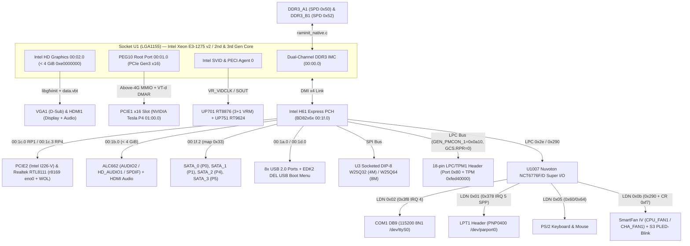

# ASRock H61M-S1 PLUS — Coreboot + EDK2 UEFI Port


%20%7C%20W25Q64%20(8M)-d97706?style=flat-square)


**Quick Navigation:**
[**Releases**](../../releases) ·
[**Features Catalog**](docs/COREBOOT-FEATURES-CATALOG.md) ·
[**Supported CPUs**](docs/SUPPORTED-CPUS.md) ·
[**Hardware Map**](docs/HARDWARE-MAP.md) ·
[**Porting & Lessons**](docs/PORTING-AND-LESSONS-LEARNED.md) ·
[**Hardware Report**](docs/HARDWARE-REPORT.md) ·
[**Blobs & Licenses**](BLOBS.md) ·
[**OS Configurator (`h61_coreboot_config.py`)**](scripts/h61_coreboot_config.py) ·
[**Agent Skills**](.agents/skills/)

Open-source **Coreboot + EDK2 `UefiPayloadPkg`** board port, Sandy/Ivy Bridge chipset patches, **iPXE UEFI Network Boot** ([`patches/0004-edk2-cbfs-ipxe-support.patch`](patches/0004-edk2-cbfs-ipxe-support.patch) + [`scripts/build_ipxe.sh`](scripts/build_ipxe.sh)), **`Delete`-key USB Boot Menu** ([`patches/0002-edk2-delete-key-usb-boot-menu.patch`](patches/0002-edk2-delete-key-usb-boot-menu.patch)), **GRUB `fwsetup` CF9 auto-reset fix & full Secure Boot + NVMe DXE support** ([`patches/0003-edk2-cf9-reset-and-secureboot-components.patch`](patches/0003-edk2-cf9-reset-and-secureboot-components.patch)), calibrated **`NCT6776F` HWM / `PECI0` SmartFan IV + `lm-sensors` board profile** ([`configs/asrock-h61m-s1-plus-sensors.conf`](configs/asrock-h61m-s1-plus-sensors.conf)), Linux OS runtime TUI/CLI configurator ([`scripts/h61_coreboot_config.py`](scripts/h61_coreboot_config.py)), ready-to-flash **4 MiB (`W25Q32`) & 8 MiB (`W25Q64`)** ROMs with committed IFD/ME/VBT blobs ([`blobs/`](blobs/)), comprehensive documentation, AI agent skills ([`.agents/skills/`](.agents/skills/)), and automated CI release pipeline ([`quarterly-release.yml`](.github/workflows/quarterly-release.yml)) for the **ASRock H61M-S1 PLUS** motherboard (`H61M-VS4 G/A 1.00`, LGA1155, Intel H61 Express `8086:1c5c`, Nuvoton `NCT6776F/D` Super I/O, Realtek `ALC662`, Realtek `RTL8111`, `W25Q32` / `W25Q64` SPI flash).

### Highlights New in `v26.11.6`
- **Built-in iPXE UEFI Network Boot (`efi/ipxe.efi` via `CbfsPayloadAssetsDxe`)**: Un-gated EDK2 `CbfsPayloadAssetsDxe` ([`patches/0004-edk2-cbfs-ipxe-support.patch`](patches/0004-edk2-cbfs-ipxe-support.patch)) loads LZMA-compressed `efi/ipxe.efi` from CBFS when `BOOTSPLASH_IMAGE=FALSE` and automatically registers **`iPXE Network Boot`** in UEFI Boot Manager (`ESC` -> Boot Manager / `efibootmgr`) without adding unused EDK2 `NetworkPkg` bloat. Built from pinned iPXE commit `7c39c04a537c` ([`scripts/build_ipxe.sh`](scripts/build_ipxe.sh)) with `DOWNLOAD_PROTO_HTTPS`, `IMAGE_TRUST_CMD`, `PING_CMD`, `NSLOOKUP_CMD`, `REBOOT_CMD`, `POWEROFF_CMD`, `NTP_CMD`, `CERT_CMD`, and `CONSOLE_EFI` only (preventing COM1 double-echo with EDK2 `TerminalDxe`).
  - **8 MiB (`W25Q64`) & 4 MiB (`W25Q32`) Minimal-ME ROMs**: Include full `bin-x86_64-efi-sb/ipxe.efi` (`360,111` B LZMA / `773,120` B decompressed; all PCI, USB, & VirtIO NIC drivers).
  - **4 MiB (`W25Q32`) Stock-ME ROM**: Includes targeted `realtek--intel--intelx--snp.efi` (`143,887` B LZMA / `290,816` B decompressed; onboard Realtek `RTL8111/8168`, Intel `I226-V`/Intel NICs, `intelx`, & UEFI `snp` fallback) leaving `53,924` B free in CBFS.
- **GitHub Actions & Build Hardening**: Upgraded `.github/workflows/quarterly-release.yml` actions to Node 24-native majors (`checkout@v6`, `upload-artifact@v6`, `download-artifact@v7`, eliminating Node 20 deprecation warnings), included `0004` + `asrock-h61m-s1-plus-sensors.conf` in release assets, and made `scripts/build.sh` fail hard if `0001` fails to apply cleanly.

### Carried Forward & Live-Verified (`v26.11.5` / `v26.11.4` / `v26.11.3`)
- **Accurate `NCT6776F` CPU `PECI Agent 0` & Closed-Loop SmartFan IV (`0x0c` vs `0x10`)**: Coreboot's generic `NUVOTON_FAN_SOURCE_PECI0` (`0x10`, meant for NCT6791D/NCT6796D) mapped to `PCH_CPU_TEMP` (`0.0°C` on H61M-S1 PLUS where pins 75/76 `MSCL/MSDA` are unwired). Setting NCT6776F-native **`NCT6776_TEMP_SRC_PECI0 = 0x0c`** (`mainboard.c`) enables real CPU die tracking on both SmartFan IV banks (`CHA_FAN1` `1920 -> 3040 RPM` under 15s load, stepping back to `1909 RPM` on cooldown as `PECI Agent 0` tracks `34.5 -> 60.0 -> 33.5°C` alongside `coretemp`).
- **Eliminated `CPUTIN = 123.5°C` & Duplicate `AUXTIN` + Cleared Bogus Boot Alarms**: `U1007` Pin 110 (`CPUTIN`) is physically unconnected on the PCB and Pins 109/111 are shorted on `MB_TEMP`. Routing `SMIOVT1 -> SYSTIN (0x01)` and `SMIOVT2 -> PECI Agent 0 (0x0c)` in Bank 6, disabling `CPUTIN` open-diode current mode (`0x5d`/`0x5e`), switching `SYSFANOUT` to PWM mode (`pwm1_mode=1`), and programming sane hardware voltage/temperature limits (`Bank 0`/`1`/`2`/`5`) removes `CPUTIN=123.5°C` and zeroes every operational HWM threshold alarm at boot.
- **Board-Calibrated `lm-sensors` & Updated `h61-coreboot-config`**: Added [`configs/asrock-h61m-s1-plus-sensors.conf`](configs/asrock-h61m-s1-plus-sensors.conf) (boardview + stock BIOS `PE2` divider formulas for `Vcore`, `+12V` `6.6x`, `+5V` `3.0x`, `AVCC`, `+3.3V`, `3VSB`, `Vbat`; ignoring unwired `PCH_*`, `SIO_IMON` `in4`, `MB_TEMP` `in6`, and unjumpered `CI1` intrusion) and updated [`scripts/h61_coreboot_config.py`](scripts/h61_coreboot_config.py) to read `in0..in8`, scaled voltages, `CHA_FAN1`/`CPU_FAN1`, operational alarms, and `Tesla P4` GPU telemetry.
- **GRUB `fwsetup` CF9 Auto-Reset (`0003`) & `Delete`-Key USB Boot Menu (`0002`)**: Live-verified via `COM5` + Ubuntu Server USB -> `Delete` `Select USB Boot Device:` -> `UEFI Firmware Settings` -> automatic cold reset (`0xcf9 0x02 -> 0x06`) straight into `UiApp`.
- **Complete Secure Boot DXE Stack + `NVME_ENABLE=TRUE`**: `Pkcs7VerifyDxe`, `RngDxe`, `Hash2DxeCrypto`, `EnrollDefaultKeys`, `SecureBootConfigDxe`, and `NvmExpressDxe` enabled in all 4 variants (Microsoft 2011+2023 keys pre-enrolled, disabled by default so unsigned drivers like `nvidia.ko` load cleanly).
- **`LPT1` (`0x378` IRQ 5 `PNP0400`), `COM1` (`0x3f8`), `LPC/TPM1` Port `0x80` + TPM Probe, & 10 OS-Writable CFR Options**.

---

## Table of Contents

1. [Disclaimers & Known Caveats](#1-disclaimers--known-caveats)
2. [Documentation Index](#2-documentation-index)
3. [Software-to-Hardware Connection Map](#3-software-to-hardware-connection-map)
4. [Ready-to-Flash ROM Variants (`v26.11.6`, Blobs Included)](#4-ready-to-flash-rom-variants-v26116-blobs-included)
5. [Verified Hardware Status (`v26.11.5`)](#5-verified-hardware-status-v26115)
6. [Configuring Coreboot & Sensors from Linux](#6-configuring-coreboot--sensors-from-linux)
7. [Building & Flashing Guide](#7-building--flashing-guide)
8. [Repository Layout](#8-repository-layout)

---

## 1. Disclaimers & Known Caveats

> [!CAUTION]
> **Hardware Risk & Recovery**: Flashing motherboard SPI firmware can permanently brick hardware if interrupted or misconfigured. This project is provided **AS IS** with **NO WARRANTY**. Always capture and verify two independent full-chip stock backups with an external SPI flash programmer before writing any ROM. Only flash ROMs matching your physical chip size (`4 MiB` `W25Q32` vs `8 MiB` `W25Q64`).

> [!WARNING]
> **Known Caveats (`v26.11.5`)**:
> - **Internal vs External SPI Flashing for Minimal ME**: If your board currently boots with a stock vendor-locked IFD (`FREG2` locked internally, `0x001000–0x17ffff`), `flashrom -p internal` can ONLY update `FREG1` (`0x180000+`) using `*-w25q64-8mb-mecleaned-compat-full.rom` (`8 MiB`) or `*-w25q32-4mb-stock-me-full.rom` (`4 MiB`). To switch to the **`124 KiB` minimal-ME (`AltMeDisable=1`) + `FLMSTR1=0xffff0000` unlocked** layout (`w25q64-8mb-minimal-me-full.rom` / `w25q32-4mb-minimal-me-full.rom`), pull socketed DIP-8 `U3` and flash once with an external SPI programmer (unlocking full-chip internal `flashrom` writes permanently afterward).
> - **Cougar Point H61 ME Requirement & `me_state`**: H61 (`Cougar Point`) hardware enforces a 30-minute power-off timer if `FTPR` (`ROMP` + `BUP`) is absent from ME; thus `me_cleaner -S -r -t -d` (`124 KiB` `FTPR` + `AltMeDisable=1`) is the minimum hardware-safe ME. Also leave runtime CFR `me_state=0` (`Normal`) when running locked stock `FREG2` ME `8.1.20.1336` (Coreboot's `me_smm.c` already hides `00:16.0` from Linux before OS handoff, whereas `me_state=1` triggers a harmless ~1.3s `ME_GEN_7` MKHI timeout warning).
> - **Hardware Monitor Nuances (`+12V` Divider & `CI1` Header)**: `in1` (`Pin 105`) uses ASRock's stock BIOS `PE2` `6.6x` (`56 kΩ / 10 kΩ`) multiplier (`live raw ~1.61 V -> 10.61–10.67 V`; adjust `compute in1` in `/etc/sensors.d/asrock-h61m-s1-plus.conf` if your board revision/multimeter indicates a different divider). When `CI1` (chassis intrusion jumper header) is left open, `Q11`/`OR4` hold `CASEOPEN0#` low so `intrusion0_alarm` remains `1` (`ignored` by default in `asrock-h61m-s1-plus-sensors.conf`).
> - **Secure Boot Default State**: Default Microsoft keys are pre-enrolled (`UserMode`) and Secure Boot enforcement is **Disabled by default** (`# CONFIG_EDK2_SECURE_BOOT_DEFAULT_ENABLE is not set`) so unsigned out-of-tree modules (e.g., Tesla P4 `nvidia.ko`) continue to load cleanly. Toggle **`Attempt Secure Boot`** under `System Configuration` -> `Secure Boot Configuration` if you only boot signed kernels/MOKs.
> - **Untested Edge Hardware (`v26.11.5`)**: `Delete` USB menu (`USB Device`), GRUB `fwsetup` auto-reset into `UiApp`, `Secure Boot Configuration`, and dynamic `PECI0` SmartFan IV + `lm-sensors` telemetry are all live-verified on hardware. Physical `VGA1` D-Sub monitor, physical LPC POST card, discrete LPC TPM 1.2 module, physical PCIe/M.2 NVMe SSD (`NvmExpressDxe` verified in `UEFIPAYLOAD.txt` only), simultaneous multi-USB-stick (`>=2`) selection, `1600 MT/s` / `1.65 V` XMP DIMMs, and `2x8` bifurcation risers remain untested directly on hardware.
> - **ACPI S3 with NVIDIA Proprietary / vGPU Driver (`NVreg_PreserveVideoMemoryAllocations=1`)**: Linux requires writing `suspend` to `/proc/driver/nvidia/suspend` before sleeping (and `resume` afterward); [`scripts/h61_coreboot_config.py`](scripts/h61_coreboot_config.py) (`s3` command & TUI) performs this handshake automatically.
> - **PCIe x16 Slot Bifurcation (`2x8` / `1x8+2x4`)**: Exposed in runtime CFR (`peg_bifurcation`); on Ivy Bridge LGA1155, splitting lanes also requires CPU `CFG[6:5]` physical hardware straps; only `1x16` (`PCIE1`) is tested on hardware.

> [!NOTE]
> **LLM / AI-Assisted Engineering Disclaimer**: Portions of the board port source files, chipset/EDK2 patches, Python TUI/CLI configurator, skill workflows, and documentation were authored or refined with **Large Language Model (LLM)** assistance under human supervision, and cross-checked against the ASRock `H61M-VS4 G/A 1.00` boardview, Intel/Nuvoton/Realtek/Winbond datasheets, stock SPI dumps, and live physical hardware telemetry.

---

## 2. Documentation Index

| Document | Contents |
|---|---|
| [**`docs/COREBOOT-FEATURES-CATALOG.md`**](docs/COREBOOT-FEATURES-CATALOG.md) | Exhaustive tables of **all** Coreboot software & hardware features (`v26.11.5` `0x0c` `PECI0` SmartFan IV + `lm-sensors`, Delete-key USB Boot Menu, `fwsetup` auto-reset, Secure Boot + NVMe DXE, `LPT1`, `LPC/TPM1`, `CFR`, `libgfxinit`, `NRI`, `W25Q32`/`W25Q64` ME variants) |
| [**`docs/SUPPORTED-CPUS.md`**](docs/SUPPORTED-CPUS.md) | Complete **Supported LGA1155 CPUs** list (Xeon E3-1200 v1/v2, Core i7/i5/i3 2xxx/3xxx, Pentium, Celeron, `UP701` `RT8876` 95 W VRM ceiling, IGD/VT-d/PCIe 3.0 caveats) |
| [**`docs/HARDWARE-MAP.md`**](docs/HARDWARE-MAP.md) | Full **Software-to-Hardware Connection Map** (CPU `U1` PEG/CFG pins, PCH GPIOs `0..75`, `NCT6776F` LDNs & HWM/voltage divider map, VRM rails, 4-variant SPI flash layouts) |
| [**`docs/PORTING-AND-LESSONS-LEARNED.md`**](docs/PORTING-AND-LESSONS-LEARNED.md) | Accumulated platform engineering knowledge (`v26.11.5` NCT6776F `PECI0` `0x0c` & floating `CPUTIN` fix, Above-4G 32-bit clamp, `PcAnsi` VT220 `Delete` decode, CF9 `0x02/0x06` `fwsetup` reset fix, `me_cleaner` `124 KiB` alignment, `ME_GEN_7` vs ME `8.1.20`) |
| [**`docs/HARDWARE-REPORT.md`**](docs/HARDWARE-REPORT.md) | Live hardware bring-up telemetry, `flashrom` verification logs, `lm-sensors` + 15s SmartFan IV load-test proof, `COM5` Delete-key & USB `fwsetup` auto-reset proof, Secure Boot UI capture, and `v26.11.5` release checksums |
| [**`BLOBS.md`**](BLOBS.md) & [**`LICENSES/`**](LICENSES/) | Complete inventory & SHA-256 hashes of all 8 committed blobs (`blobs/`) + open-source/proprietary licenses |
| [**`.agents/skills/`**](.agents/skills/) | Reusable AI agent workflows (`coreboot-build-and-flash`, `edk2-usb-boot-and-me-variants`, `h61m-s1-plus-linux-bringup`, `serial-communication`, `bios-image-inspection`) |

---

## 3. Software-to-Hardware Connection Map

### Mermaid Architecture Diagram



---

## 4. Ready-to-Flash ROM Variants (`v26.11.6`, Blobs Included)

All 4 full ROM images (each bundling **`efi/ipxe.efi`** for UEFI Network Boot) are published under [**Releases (`v26.11.6`)**](../../releases/tag/v26.11.6), built from reproducible defconfigs in [`configs/`](configs/) with [`blobs/`](blobs/) (`IFD` with `FLMSTR1=0xffff0000`, `ME`, and desktop `data.vbt`), and verified with `ifdtool -d`, `me_cleaner.py -c` (`FTPR` RSA VALID), and `cbfstool`:

| Release Artifact (`*-full.rom`) | Flash Chip | Intel ME (`0x001000+`) | `AltMeDisable` | iPXE (`efi/ipxe.efi`) | BIOS Offset / Size | CBFS Free Space | SHA-256 | Flash Notes |
|---|---|---|---:|---|---|---:|---|---|
| **`h61m-s1-plus-coreboot-v26.11.6-w25q64-8mb-minimal-me-full.rom`** | `W25Q64` (`8 MiB`) | `124 KiB` (`me_cleaner -S -r -t -d`) | **Yes (`1`)** | Full (`360,111` B LZMA) | `0x020000` (`7.875 MiB`) | `5,473,892` B | `36083329cf60517a26fcd625495852faf0f236d37aac921047ca602862957a6f` | **Recommended (`8 MiB`, Minimal/Disabled ME)**: Flash once externally on `U3` (permanently unlocks IFD for future internal updates!) |
| **`h61m-s1-plus-coreboot-v26.11.6-w25q64-8mb-mecleaned-compat-full.rom`** | `W25Q64` (`8 MiB`) | `1532 KiB` (`me_cleaner -S -d`) | Yes (`1`, IFD) | Full (`360,111` B LZMA) | `0x180000` (`6.5 MiB`) | `4,032,100` B | `2dba64227a4f7d8822085777db65e5dc39a20fb9da368831cabfcf2f12cbcc42` | **With ME (`8 MiB`, Internal Compatible)**: Compatible with `flashrom -p internal --ifd -i bios` on locked stock IFD |
| **`h61m-s1-plus-coreboot-v26.11.6-w25q32-4mb-minimal-me-full.rom`** | `W25Q32` (`4 MiB`) | `124 KiB` (`me_cleaner -S -r -t -d`) | **Yes (`1`)** | Full (`360,111` B LZMA) | `0x020000` (`3.875 MiB`) | `1,279,524` B | `de1cfaebf996c78f176980356272410763ded97d100fdec6a2619f9de9267a3f` | **Recommended (`4 MiB`, Minimal/Disabled ME)**: Flash once externally on `U3` to reclaim `3.875 MiB` BIOS + minimal ME |
| **`h61m-s1-plus-coreboot-v26.11.6-w25q32-4mb-stock-me-full.rom`** | `W25Q32` (`4 MiB`) | Stock `8.1.20.1336` (`1532 KiB`) | No (`0`) | Slim `realtek--intel--intelx--snp` (`143,887` B LZMA) | `0x180000` (`2.5 MiB`) | `53,924` B | `5730e1703b49627effcdc4e2ea735eddd86ba998aa4a677a59cbb120cc32ef95` | **With Stock ME (`4 MiB`, Internal Compatible)**: `flashrom --ifd -i bios` compatible on stock `4 MiB` `W25Q32` |

---

## 5. Verified Hardware Status (`v26.11.5`)

Tested via internal `flashrom -p internal -c "W25Q64BV/W25Q64CV/W25Q64FV" --ifd -i bios --noverify-all` (`w25q64-8mb-mecleaned-compat-full.rom`) on physical ASRock H61M-S1 PLUS (`Intel Xeon E3-1275 v2`, 2× 8 GB DDR3, NVIDIA Tesla P4 in `PCIE1`, Intel I226-V in `PCIE2`, Ubuntu 26.04 `7.0.0-43-generic`):

| Subsystem | Observed Hardware Result (`v26.11.5`) |
|---|---|
| **SPI Flash (`W25Q64`)** | `SF: Detected ef 4017` (`8 MiB`), `RW_MRC_CACHE` (`64 KiB`), `SMMSTORE` (`256 KiB` EFI FV), `COREBOOT` (`6.5 MiB` / `4,408,548` B free), `VERIFIED` internal flash (`FLASH_EXIT_CODE: 0`) |
| **NCT6776F Sensors & `SmartFan IV` (`0x0c` `PECI0`)** | `sensors` reports `M/B Temp = +32.0°C` (`SYSTIN`), `CPU Temp (PECI) = +34.5°C` (`temp7`, tracking `coretemp` `Package id 0`), `CHA_FAN1 = 1909–1920 RPM`, `CPU_FAN1 = 1728–1781 RPM`, `Vcore`, `+12V`, `AVCC`, `+3.3V`, `+5V`, `3VSB`, `Vbat`, **zero** operational HWM alarms, and no `CPUTIN=123.5°C` / `PCH_*`; during 15s CPU load, `PECI0` rose `34.5 -> 60.0 -> 33.5°C` and `pwm1`/`pwm2` ramped `89/76 -> 148/152 -> 89/76` (`CHA_FAN1` `1920 -> 3040 -> 1909 RPM`) |
| **Serial & Parallel (`NCT6776F`)** | **`COM1`** (`0x3f8` IRQ 4, `PNP0501`) `115200 8N1` + **`LPT1`** (`0x378` IRQ 5 DRQ 4 SPP `CRf0=0x38`, `PNP0400`, `/dev/parport0`) **both active** (`COM1=True`, `LPT1=True` in `self-test`) |
| **`Delete`-Key USB Boot Menu & GRUB `fwsetup`** | Carried from `v26.11.4` live `COM5` test (`Delete` `\x1b[3~` -> `Select USB Boot Device:` -> Ubuntu Server USB -> `UEFI Firmware Settings` -> automatic cold reset `CF9 0x02/0x06` into `UiApp`) |
| **UEFI Secure Boot & NVMe DXE** | `SecBoot: Disabled (UserMode, keys_enrolled=True, PK=1575B KEK=3066B db=7636B dbx=21416B)`; `NvmExpressDxe`, `Pkcs7VerifyDxe`, `RngDxe`, `Hash2DxeCrypto`, `EnrollDefaultKeys`, `SecureBootConfigDxe` active |
| **OS Runtime CFR (`efivarfs`)** | All **10 CFR options** exposed in `efivars` (`0x00000007 present=True`), `sudo h61-coreboot-config self-test` -> **`RESULT: PASS`** |
| **Intel ME Visibility in OS** | Coreboot `me_smm.c` (`RCBA32_OR(FD2, PCH_DISABLE_MEI1)`) hides PCI `00:16.0` before OS handoff (`lspci -s 00:16.0` empty!) |
| **Memory, IGD, GPU, LAN, S3** | `16 GiB` dual-channel DDR3 `1330 MHz` (`1333 MT/s`); `00:02.0` (`<4G`) `libgfxinit` + `vbt.bin`; `01:00.0` `Tesla P4` (`35°C`, `10.12 W`, `nvidia-smi -L` active); `I226-V` + `RTL8111` active |

---

## 6. Configuring Coreboot & Sensors from Linux

> [!TIP]
> Configure all **10 Coreboot BIOS options**, install board sensor scaling, and inspect live hardware metrics directly from Linux (headlessly over SSH or `COM1`):

```bash
sudo install -m 0755 scripts/h61_coreboot_config.py /usr/local/bin/h61-coreboot-config
sudo install -m 0644 configs/asrock-h61m-s1-plus-sensors.conf /etc/sensors.d/asrock-h61m-s1-plus.conf
sudo sensors -s && sensors

# Optional: Combined Tesla P4 GPU (>= 60 C -> 100%) + CPU PECI0 fan controller (auto fallback to mode 5)
sudo install -m 0755 scripts/h61_fan_control.py /usr/local/bin/h61-fan-control
sudo install -m 0644 configs/h61-fan-control.service /etc/systemd/system/h61-fan-control.service
sudo systemctl daemon-reload && sudo systemctl enable --now h61-fan-control.service

sudo h61-coreboot-config                   # Interactive 4-tab curses TUI
sudo h61-coreboot-config self-test         # Verify 10 CFR efivars, COM1, LPT1, WOL, & NCT6776 HWM
sudo h61-coreboot-config status            # Live system telemetry, scaled volts, fans, PWMs, & GPU
sudo h61-coreboot-config list              # List all 10 CFR options
sudo h61-coreboot-config set fan_profile quiet
sudo h61-coreboot-config s3 --seconds 15   # Safe S3 suspend with NVIDIA procfs handshake
sudo h61-coreboot-config flash <full.rom>  # Safe internal 4M/8M '--ifd -i bios' flash
```

---

## 7. Building & Flashing Guide

### Option 1: Flash Pre-Built Public Release ROMs (`blobs/` Included)
Download your target variant from [**Releases (`v26.11.6`)**](../../releases/tag/v26.11.6) and verify `SHA256SUMS.txt`:
- **External SPI Programmer (Recommended once on socketed `U3`)**: Flash `h61m-s1-plus-coreboot-v26.11.6-w25q64-8mb-minimal-me-full.rom` (`W25Q64`) or `...-w25q32-4mb-minimal-me-full.rom` (`W25Q32`). Unlocks `FLMSTR1=0xffff0000` for future internal updates and activates `124 KiB` minimal ME + `AltMeDisable=1`.
- **Internal `flashrom` from Linux (`FREG2` still vendor-locked)**:
  ```bash
  sudo flashrom -p internal -c "W25Q64BV/W25Q64CV/W25Q64FV" --ifd -i bios --noverify-all \
    -w h61m-s1-plus-coreboot-v26.11.6-w25q64-8mb-mecleaned-compat-full.rom
  ```

### Option 2: Build All 4 Variants From Source
Inside `coreboot/coreboot-sdk:latest` (or Ada-enabled Coreboot toolchain with `gnat`):

```bash
git clone https://github.com/coreboot/coreboot.git
cd coreboot && git checkout df45ea2c49b4c7f6a1d2a969934cf6c6a2cb9018
cd ..
COREBOOT_DIR="$PWD/coreboot" RELEASE_TAG="v26.11.6" bash scripts/build_all_roms.sh
```

*(Or assemble custom stock dumps using [`scripts/assemble_full_rom.sh`](scripts/assemble_full_rom.sh) with `--stock-dump`, `--bios-region`, `--bios-offset`, `--rom-size`, `--vbt`, `--me-cleaner`.)*

---

## 8. Repository Layout

```text
.
├── .agents/skills/                         # AI agent workflows & Win32 COM5 serial tools
├── .github/workflows/quarterly-release.yml # Automated multi-variant CI build & release pipeline
├── LICENSES/                               # GPL-2.0, BSD-2-Clause-Patent, Intel Microcode licenses
├── blobs/                                  # Committed IFD (4M/8M unlocked), ME (stock/compat/minimal-124k), & data.vbt
├── board/src/mainboard/asrock/h61m-s1-plus/# Coreboot mainboard port (COM1+LPT1, LPC/TPM1, 10 CFR, SmartFan IV, NCT6776 HWM)
├── configs/                                # 4 variant defconfigs, lm-sensors conf, & h61-fan-control.service
├── docs/                                   # Features catalog, CPU list, hardware map, porting lessons, live report
├── patches/
│   ├── 0001-sandybridge-h61m-s1-plus-igd-raminit.patch          # <4G clamp, NRI/PEG, me_state CFR runtime flag
│   ├── 0002-edk2-delete-key-usb-boot-menu.patch                 # EDK2 Del USB Boot Menu, PcAnsi ESC[3~ fix, BDS Port 0x80
│   ├── 0003-edk2-cf9-reset-and-secureboot-components.patch     # CF9 0x02/0x06 fwsetup reset fix & Pkcs7Verify/Rng/Hash2 DXE
│   └── 0004-edk2-cbfs-ipxe-support.patch                       # Un-gate CbfsPayloadAssetsDxe for CBFS efi/ipxe.efi loading
├── scripts/
│   ├── build_all_roms.sh                   # Builds & validates all 4 W25Q32/W25Q64 full ROMs + SHA256SUMS.txt
│   ├── build_ipxe.sh                       # Builds pinned iPXE UEFI binaries (ipxe-full.efi & ipxe-h61-slim.efi)
│   ├── build.sh                            # Single-variant Coreboot + EDK2 builder & ifdtool/me_cleaner validator
│   ├── assemble_full_rom.sh                # Stitches 4M/8M IFD + ME + BIOS region (+ optional VBT & me_cleaner)
│   ├── h61_coreboot_config.py              # Linux OS runtime 10-option CFR TUI & CLI configurator
│   └── h61_fan_control.py                  # Fail-safe combined GPU (Tesla P4 >= 60C -> 100%) + CPU PWM daemon
├── BLOBS.md                                # Blob provenance, SHA-256 hashes, & 124 KiB minimal-ME layout notes
└── README.md                               # Project overview & software-to-hardware connection map
```
