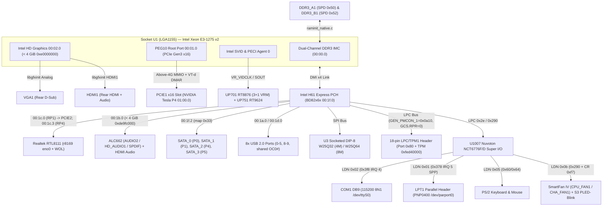

# Software-to-Hardware Connection Map — ASRock H61M-S1 PLUS

**Quick Navigation:**
[**Home (`README.md`)**](../README.md) ·
[**Features Catalog**](COREBOOT-FEATURES-CATALOG.md) ·
[**Supported CPUs**](SUPPORTED-CPUS.md) ·
[**Hardware Map**](HARDWARE-MAP.md) ·
[**Porting & Lessons**](PORTING-AND-LESSONS-LEARNED.md) ·
[**Hardware Report**](HARDWARE-REPORT.md) ·
[**Blobs & Licenses**](../BLOBS.md)

Authoritative wiring, register, PCI/ACPI/IRQ, Coreboot driver, and Linux sysfs map cross-verified against the **ASRock `H61M-VS4 G/A 1.00` (`H61M-S1 PLUS R1.01`) boardview**, Coreboot `v26.11.4` source code, `inteltool -G`, `/dev/port`, and live Ubuntu `7.0.0-43-generic` telemetry (`h61`).

> [!NOTE]
> Every pin, PCI BDF, I/O port, MMIO base, and GPIO direction in this document is cross-checked against the physical boardview netlist and live runtime measurements (`lspci -vvv`, `/dev/port`, `inteltool -G`).

## Table of Contents

1. [System Hardware-to-Software Topology](#1-system-hardware-to-software-topology)
2. [Master Software-to-Hardware Connection Matrix](#2-master-software-to-hardware-connection-matrix)
3. [CPU `U1` PEG Lane-to-`PCIE1` Pinout & `CFG` Straps](#3-cpu-u1-peg-lane-to-pcie1-pinout--cfg-straps)
4. [H61 PCH GPIO Wiring (`board/gpio.c` + `inteltool -G`)](#4-h61-pch-gpio-wiring-boardgpioc--inteltool--g)
5. [Nuvoton `NCT6776F/D` (`U1007`, PNP `0x2e`, ID `0xc333`) Map](#5-nuvoton-nct6776fd-u1007-pnp-0x2e-id-0xc333-map)
6. [Power Regulation Architecture (Zero Programmable PMIC Firmware)](#6-power-regulation-architecture-zero-programmable-pmic-firmware)
7. [SPI Flash Layout (`W25Q64`, 8 MiB `0x000000–0x7fffff`)](#7-spi-flash-layout-w25q64-8-mib-0x0000000x7fffff)

---

## 1. System Hardware-to-Software Topology

### Mermaid Block Diagram



### Detailed ASCII Interconnect Map

```text
                           +---------------------------------------------------+
                           |    2x 240-pin DDR3 UDIMM Slots                    |
                           |    DDR3_A1 (SPD 0x50)  |  DDR3_B1 (SPD 0x52)      |
                           +-------------------------+-------------------------+
                                                     ^  SMBus 0x400 + Dual-Channel IMC
                                                     v  (sandybridge/raminit_native.c)
+---------------------------------------------------------------------------------------------------+
|  Socket U1 (LGA1155) — Intel Xeon E3-1275 v2 (4C/8T Ivy Bridge, 8086:0158 / 8086:0151 / 8086:016a)|
|                                                                                                   |
|  * CPU Cores + VT-x + VT-d + AES-NI/AVX  --> model_206ax (microcode 06-3a-09 rev 0x21)            |
|  * IGD 00:02.0 (8086:016a, <4G 0xe0000000) --+-> PCH CRT/DAC ---> VGA1 (D-Sub, libgfxinit Analog) |
|                                              +-> PCH DDPB    ---> HDMI1 (TMDS, libgfxinit HDMI1)  |
|  * PEG10 00:01.0 (x16, CFG[6:5] on U1) --------> PCIE1 x16  ---> NVIDIA Tesla P4 (01:00.0, >4G)   |
|  * Intel SVID Bus (VIDCLK/SOUT/ALERT#) --------> UP701 (RT8876 3+1 VRM) + UP751 (RT9624 VAXG)     |
|  * Single-Wire PECI (pin 115 on U1007) --------> NCT6776F PECI Agent 0                            |
+----------------------------------------------------+----------------------------------------------+
                                                     | DMI Link
                                                     v
+---------------------------------------------------------------------------------------------------+
|  Intel H61 Express PCH (BD82x6x, PCI 00:1f.0 ID 8086:1c5c)                                        |
|  +-- 00:16.0 MEI1 (8086:1c3a, hidden in Linux OS by me_smm.c; optional 124K AltMeDisable=1)       |
|  +-- 00:1a.0 EHCI2 (8086:1c2d, GPE /proc EHC2) -+-> USB2 Ports 0-5, 8-9 (Rear + Headers; OC0#)    |
|  +-- 00:1d.0 EHCI1 (8086:1c26, GPE /proc EHC1) -+                                                 |
|  +-- 00:1b.0 HD Audio (8086:1c20, <4G)                                                            |
|  |     +-- SDIN0 addr 0 -> AU1 Realtek ALC662 (10ec:0662) -> AUDIO2 (Rear) + HD_AUDIO1 + SPDIF_OUT|
|  |     +-- Codec addr 3 -> Intel CougarPoint HDMI (8086:2805) -> Pin 0x05 DDPB -> HDMI1           |
|  +-- 00:1c.0 PCIe RP1 -> PCIE2 x1 Slot (e.g. Intel I226-V 8086:125c at 02:00.0 when populated)*   |
|  +-- 00:1c.3 PCIe RP4 -> Realtek RTL8111 (10ec:8168) -> r8169 eno0 (WOL S4 _PRW)                  |
|  +-- 00:1f.2 SATA AHCI (8086:1c02, map 0x33)  -> SATA_0 (P0), SATA_1 (P1), SATA_2 (P4), SATA_3(P5)|
|  +-- 00:1f.3 SMBus (8086:1c22, I/O 0x400)     -> SPD 0x50 / 0x52 (i2c_i801 / ee1004)              |
|  +-- 00:1f.0 SPI Bus  -> Socketed U3 (W25Q32 4 MiB or W25Q64 8 MiB; Stock/Compat 0x180000 or Min-ME 0x020000)|
|  +-- 00:1f.0 LPC Bus (33 MHz CLK_PCH_PORT80 free-running: GEN_PMCON_1=0x0a10, LPC_EN=0x3c0f, GCS.RPR=0)|
|        +-- 18-pin LPC/TPM1 Header (Port 0x80 POST Coreboot+EDK2 0xE1..0xE8 & TIS TPM 0xfed40000)  |
|        +-- U1007 Nuvoton NCT6776F/D Super I/O (PNP 0x2e, ID 0xc333, HWM 0x290)                    |
|              +-- LDN 0x01 LPT1     : 0x378 IRQ5 DRQ4 CRf0=0x38 (PNP0400, /dev/parport0, SPP)      |
|              +-- LDN 0x02 COM1     : 0x3f8 IRQ4 -> U11 RS-232 -> COM1 DB9 (/dev/ttyS0 115200 8N1) |
|              +-- LDN 0x05 KBC      : 0x60/0x64 IRQ1/12 -> PS/2 Keyboard & Mouse (PNP0303/PNP0F13) |
|              +-- LDN 0x0b HWM/FLED : 0x290 -> CPU_FAN1 (Bank2), CHA_FAN1 (Bank1), PLED- (CR 0xf7) |
+---------------------------------------------------------------------------------------------------+
* PCH PCIe Port Remap Note: When PCIE2 (pcie_rp1) is empty, Coreboot remaps RTL8111 (pcie_rp4) to 00:1c.0 -> 02:00.0; when PCIE2 holds a card (e.g. Intel I226-V), PCIE2 takes 00:1c.0 -> 02:00.0 and RTL8111 takes 00:1c.3 -> 03:00.0 (`eno0` via Netplan MAC match).
```

---

## 2. Master Software-to-Hardware Connection Matrix

| Subsystem | Board Component / Connector / Net | Hardware Address / PCI BDF / I/O / IRQ | Coreboot Source File(s) | Linux Driver & Runtime Sysfs / Device Path |
|---|---|---|---|---|
| **CPU & Microcode** | `U1` LGA1155 Xeon `E3-1275 v2` (`3.5/3.9 GHz`) | CPUID `0x306a9` (`model_206ax`), `APIC 0..7` | `src/cpu/intel/model_206ax/`, `cpu_microcode_blob.bin` (`06-3a-09` `rev 0x21`) | `x86_64`, `coretemp` (`/sys/class/hwmon/hwmon1`), `intel_pstate`/`acpi_cpufreq` |
| **Memory Controller & SPD** | `DDR3_A1` (`SA2:0=000` -> `RP12`) & `DDR3_B1` (`SA2:0=010` -> `RP13/RP14`) | `00:00.0` (`8086:0158`), SMBus `0x50` & `0x52` | `devicetree.cb` (`spd_addresses`), `northbridge/intel/sandybridge/raminit_native.c` | `edac` / `i2c_i801`, `ee1004` / `/sys/bus/i2c/devices/*-0050` |
| **Integrated Display** | PCH `CRT` DAC -> **`VGA1`**; PCH `DDPB` -> **`HDMI1`** | `00:02.0` (`8086:016a`, BARs `< 4 GiB`: `0xdec00000`, `0xe0000000`) | `gma.c`, `gma-mainboard.ads`, `fb_console.c` | `i915` (`/dev/dri/card1`, `/sys/class/drm/card1-HDMI-A-1`, `fb0`) |
| **PCIe x16 Slot (`PCIE1`)** | `PCIE1` wired to `U1` PEG lanes `0–15`; **`Tesla P4`** (`10de:1bb3`) | Bridge `00:01.0` (`8086:0151`) -> `01:00.0` (Above-4G `0xfe0000000`/`0xff0000000`) | `devicetree.cb` (`peg10..12`), `cfr.c`, `northbridge.c`, `dsdt.asl` (`PEGP`) | `pcieport`, `nvidia` / `nvidia_vgpu_vfio` (`/proc/driver/nvidia/suspend`) |
| **PCIe x1 Slot (`PCIE2`)** | `PCIE2` wired to PCH Root Port 1 | `pcie_rp1` (disabled when empty; remaps when populated) | `devicetree.cb` (`device ref pcie_rp1 on`) | Dynamic `00:1c.0` when card installed |
| **Onboard Gigabit LAN** | Realtek `RTL8111` IC + `LAN_25M` (`GPIO66`) + RJ45 | `00:1c.0` (`8086:1c16` RP4) -> `02:00.0` (`10ec:8168`), MSI-X IRQ 29, WOL `_PRW` | `devicetree.cb` (`pcie_rp4`), `dsdt.asl` (`RP01`/`RP04`), `gpe0_en=0x2a40` | `r8169` (`eno0` at `192.168.1.24`, `ethtool`, `/proc/acpi/wakeup`) |
| **HD Audio + HDMI Audio** | `AU1` `ALC662`, `AUDIO2` rear, `HD_AUDIO1` front, `SPDIF_OUT1`, `HDMI1` | `00:1b.0` (`8086:1c20`, `< 4 GiB` `0xdebfc000`, IRQ 31), Codecs `0` & `3` | `hda_verb.c`, `bd82x6x/azalia.c` | `snd_hda_intel`, `snd_hda_codec_alc662` (`/proc/asound/card0`, `hwC0D0`/`hwC0D3`) |
| **SATA Storage** | `SATA_0` (P0), `SATA_1` (P1), `SATA_2` (P4), `SATA_3` (P5) | `00:1f.2` (`8086:1c02` AHCI), `sata_port_map = 0x33` | `devicetree.cb` (`sata1`, `sata_mode` CFR) | `ahci` (`/sys/class/ata_port/ata*`, `/dev/sd*`) |
| **USB 2.0 Host Controllers** | Rear stacked USB + Internal `USB_*` headers (`Ports 0–5, 8–9`, shared `OC0#`) | `00:1a.0` (`EHC2`, `1c2d`) & `00:1d.0` (`EHC1`, `1c26`) | `devicetree.cb` (`usb_port_config`), `dsdt.asl` (`EHC1`/`EHC2`) | `ehci-pci` (`/sys/bus/usb/devices/usb1`, `usb2`) |
| **Intel ME Interface** | Embedded ME `8.1.20.1336` (`FREG2`) | `00:16.0` (`8086:1c3a`, `< 4 GiB` `0xdebf7000`) | `bd82x6x/me.c` | `mei_me` (`/dev/mei0`) |
| **SPI Flash (`W25Q64`)** | `U3` Socketed DIP-8 (`ef 40 17`, `8 MiB`) | `PCH SPI` (`0xfed1f800` RCBA SPIBAR, mapped `0xff800000`) | `board/Kconfig` (`8192 KiB`), `SMMSTORE` (`0x190000`) | `flashrom -p internal -c "W25Q64BV/W25Q64CV/W25Q64FV" --ifd -i bios` |
| **Serial Console (`COM1`)** | `U1007` `LDN 0x02` -> `U11` transceiver -> `COM1` DB9 | I/O `0x3f8`, IRQ `4`, ACPI `PNP0501`, `115200 8N1` | `devicetree.cb` (`2e.2` + globals), `early_init.c`, `acpi/superio.asl` | `8250_pnp` (`/dev/ttyS0`, `serial-getty@ttyS0.service`) |
| **Parallel Port (`LPT1`)** | `U1007` `LDN 0x01` -> DB25 `LPT1` header | **Enabled** (`0x378`, IRQ `5`, DRQ `4`, `CRf0=0x38` SPP, `LPC_EN[2]=1`) | `devicetree.cb` (`2e.1 on`), `early_init.c` (`lpt_setup`), `mainboard.c`, `acpi/superio.asl` | `parport_pc` (`/dev/parport0`, `PNP0400`, `0378-037a`) |
| **PS/2 KB & Mouse** | `U1007` `LDN 0x05` -> Stacked PS/2 / KB/MS ports | I/O `0x60`/`0x64`, IRQ `1`/`12`, ACPI `PNP0303`/`PNP0F13` | `devicetree.cb` (`2e.5 on`), `acpi/superio.asl` | `i8042`, `atkbd`, `psmouse` |
| **Sensors & SmartFan IV** | `U1007` `LDN 0x0b` -> `CPU_FAN1` (Bank 2), `CHA_FAN1` (Bank 1), `PECI0` (pin 115) | LPC I/O `0x290..0x29f` (`gen1_dec`), `PECI0` | `mainboard.c` (`platform_late_init`), `cfr.c` (`fan_profile`) | `nct6775` (`/sys/class/hwmon/hwmon0`, `pwm1`/`pwm2` mode `5`) |
| **Front-Panel `PLED-`** | `U1007` `LDN 0x08` (`GP10`=`GRN_LED`) + `LDN 0x0b` `CR 0xf7` | `CR 0xf7`: `0x07` (S0 steady), `0x44` (S3 0.5 Hz blink), `0x00` (S4/S5 off) | `early_init.c` (`sio_pled_steady_on`), `smihandler.c` (`mainboard_smi_sleep`) | Autonomous Super I/O & SMM hardware state |
| **`LPC/TPM1` Header** | 18-pin `LPC/TPM1` header (`CLK_PCH_PORT80` pin 1) | LPC Port `0x80`, `RCBA_GCS=0x00000c21` (`RPR=0`), `GEN_PMCON_1=0x0a10`, TPM `0xfed40000` | `board/Kconfig` (`DEFAULT_POST_ON_LPC`, `MAINBOARD_HAS_TPM1`, `MEMORY_MAPPED_TPM`), `devicetree.cb` (`0c31.0`), `mainboard.c`, `PlatformBootManager.c` (`0xE1..0xE8`) | Hardware LPC POST reader / TIS 1.2 TPM (`tpm_tis`) when populated |
| **UEFI Variable Store** | `FMAP` `SMMSTORE` (`256 KiB` at `0x190000` or `0x030000`) | EFI GUID `ceae4c1d-335b-4685-a4a0-fc4a94eea085` | `cfr.c` + `bd82x6x/cfr.c` (`CFR_OPTFLAG_RUNTIME`), EDK2 `CfrSetupMenuDxe` | `efivarfs` (`/sys/firmware/efi/efivars/*-ceae4c1d-...`), `h61_coreboot_config.py` (10 options) |

---

## 3. CPU `U1` PEG Lane-to-`PCIE1` Pinout & `CFG` Straps

From the ASRock `H61M-S1 PLUS R1.01` (`H61M-VS4`) boardview (all 16 CPU PEG lanes route directly to `PCIE1`; `HSI`/`HSO` are the boardview connector labels):

| PEG Lane | CPU RX P/N (`U1`) | CPU TX P/N (`U1`) | `PCIE1` HSI P/N Pins | `PCIE1` HSO P/N Pins |
|---:|---|---|---|---|
| 0 | `B11 / B12` | `C13 / C14` | `A16 / A17` | `B14 / B15` |
| 1 | `D12 / D11` | `E14 / E13` | `A21 / A22` | `B19 / B20` |
| 2 | `C10 / C9` | `G14 / G13` | `A25 / A26` | `B23 / B24` |
| 3 | `E10 / E9` | `F12 / F11` | `A29 / A30` | `B27 / B28` |
| 4 | `B8 / B7` | `J14 / J13` | `A35 / A36` | `B33 / B34` |
| 5 | `C6 / C5` | `D8 / D7` | `A39 / A40` | `B37 / B38` |
| 6 | `A5 / A6` | `D3 / C3` | `A43 / A44` | `B41 / B42` |
| 7 | `E2 / E1` | `E6 / E5` | `A47 / A48` | `B45 / B46` |
| 8 | `F4 / F3` | `F8 / F7` | `A52 / A53` | `B50 / B51` |
| 9 | `G2 / G1` | `G10 / G9` | `A56 / A57` | `B54 / B55` |
| 10 | `H3 / H4` | `G5 / G6` | `A60 / A61` | `B58 / B59` |
| 11 | `J1 / J2` | `K7 / K8` | `A64 / A65` | `B62 / B63` |
| 12 | `K3 / K4` | `J5 / J6` | `A68 / A69` | `B66 / B67` |
| 13 | `L1 / L2` | `M8 / M7` | `A72 / A73` | `B70 / B71` |
| 14 | `M3 / M4` | `L6 / L5` | `A76 / A77` | `B74 / B75` |
| 15 | `N1 / N2` | `N5 / N6` | `A80 / A81` | `B78 / B79` |

**Unstrapped CPU `CFG[0:17]` Pads (`U1`)**: `CFG[0]` `H36`, `CFG[1]` `J36`, `CFG[2]` `J37`, `CFG[3]` `K36`, `CFG[4]` `L36`, `CFG[5]` `N35` (PEG bifurcation bit 0), `CFG[6]` `L37` (PEG bifurcation bit 1), `CFG[7]` `M36`, `CFG[8]` `J38`, `CFG[9]` `L35`, `CFG[10]` `M38`, `CFG[11]` `N36`, `CFG[12]` `N38`, `CFG[13]` `N39`, `CFG[14]` `N37`, `CFG[15]` `N40`, `CFG[16]` `G37`, `CFG[17]` `G36`. *(None are pulled down by board straps; `2x8` requires `CFG[5]=0`, `1x8+2x4` requires `CFG[6:5]=00`.)*

---

## 4. H61 PCH GPIO Wiring (`board/gpio.c` + `inteltool -G`)

Verified against vendor `SBPEI.efi` GPIO override table, live `inteltool -G`, and the boardview:

| GPIO Range | Key Mapped Pins & Boardview Nets |
|---|---|
| **`GPIO 0–15`** | `GPIO1` Input (`+3V` pull-up via `R252`); `GPIO2–5` Output (`PIRQE..H#` unused); `GPIO6` Input (`FP_PRES#` audio front-panel detect); `GPIO9–10` Native (`OC5#`/`OC6#` shared `OC0#`); `GPIO11` Native (`SMBALERT#`); `GPIO12` Native Out (`LAN_PHY_PWR_CTRL`); **`GPIO13` Input Inverted** (`O_PME#` from NCT6776) |
| **`GPIO 16–31`** | `GPIO17` Input High; `GPIO18` Native (`CLKOUT_DP_N`); `GPIO19` Native Out (`SATA1GP`); `GPIO20` Native (`SMI#/CLKREQ_PCIE`); **`GPIO21` Native** (`BIOS_WP#` / `SATA0GP` — kept native); `GPIO22` Native (`SCLOCK`); `GPIO23` Native (`LDRQ1#`); `GPIO24` Native (`MEM_LED`); `GPIO30` Native (`SUS_PWR_DN_ACK`); `GPIO31` Input (`ACPRESENT`) |
| **`GPIO 32–47`** | `GPIO32` Out (`PM_CLKRUN#`); `GPIO38–39` Native (`SLOAD`, `SDATAOUT0`); `GPIO40–43` Native (`OC1#..OC4#` shared `OC0#`); `GPIO47` Native (`PEG_B_CLKREQ#`) |
| **`GPIO 48–63`** | `GPIO48` Native (`SDATAOUT1`); `GPIO49` In (`TEMP_ALERT#`); `GPIO50–55` Native (`REQ1..3#`, `GNT1..3#`); `GPIO56` Native (`PEG_A_CLKREQ#`); `GPIO58` Native (`SML1CLK`); **`GPIO59` Native (`OC0#` shared USB overcurrent net)**; `GPIO60` (`SML0ALERT#`, `DRAM_RESET_GATE_GPIO=60`); `GPIO61` (`SUS_STAT#`); `GPIO62` (`SUSCLK`); `GPIO63` (`SLP_S5#`) |
| **`GPIO 64–75`** | `GPIO64–65` Native Out (`CLKOUTFLEX0/1`); **`GPIO66` Native Out (`CLKOUTFLEX2` -> `LAN_25M` clock for RTL8111 `UG5`)**; **`GPIO67` Native Out (`CLKOUTFLEX3` -> `PCH_CK_48M_SIO` 48 MHz clock for NCT6776F)**; `GPIO68–71` (`TACH4–7`, pull-ups); `GPIO72` In (`BATLOW#`); `GPIO73` (`PCIECLKRQ0#`); `GPIO74–75` (`SML1ALERT#`/`DATA`) |

---

## 5. Nuvoton `NCT6776F/D` (`U1007`, PNP `0x2e`, ID `0xc333`) Map

- **Global Multi-Function & Clock Straps** (configured in `early_init.c` AND attached to `device pnp 2e.2` COM1 in `devicetree.cb` so disabling LPT `2e.1` never skips them):
  `CR 0x13=0xff`, `0x14=0xff`, `0x1b=0x68`, `0x1c=0x80`, `0x24=0x5c` (`48 MHz` from `GPIO67`), `0x27=0x80`, `0x2a=0x60` (**enables COM1 pins**), `0x2c=0x80`, `0x2f=0x03`.
- **Logical Devices**:
  - `LDN 0x00` (FDC): Off (`CR 0x30=0x00`).
- `LDN 0x01` (**LPT1**): **On** (`0x378`, `IRQ 5`, `DRQ 4`, `CR 0x30=0x01`, `CR 0xf0=0x38` SPP/bi-directional, `#define NCT6776_SHOW_PP`, `LPC_EN[2]=1`).
- `LDN 0x02` (**COM1**): **On** (`0x3f8`, `IRQ 4`, `CR 0x30=0x01`, `U11` RS-232 transceiver).
  - `LDN 0x05` (**KBC**): **On** (`0x60`/`0x64`, `IRQ 1`/`12`, `CR 0xf0=0x83`).
  - `LDN 0x08 / 0x308` (**WDT1 + GPIO1**): WDT1 off (`CR 0xf5=0x00`); **`CR 0xf0=0xd8, 0xf1=0x1e, 0xf4=0x01`** muxes **`GP10` to `GRN_LED`** (`PLED-`).
  - `LDN 0x0a` (**ACPI**): `CR 0xe0=0x01`, `0xe6=0x4c`, `0xf0=0x40`, `0xf2=0x5c`, `0xf7=0xc0`.
  - `LDN 0x0b` (**HWM & Front-Panel LED**): Base **`0x0290`**, `CR 0x30=0xe1`, **`CR 0xf7 = 0x07` (S0 steady ON)** / **`0x44` (S3 0.5 Hz blink in SMM)** / **`0x00` (S4/S5 off)**, `CR 0xf8=0x00`.
  - **Key `U1007` Physical Pins**: Pins `60–61` power button; pin `63` ATX `PSON#`; pin `64` `SLP_S3#`; pins `77–79` PCIe/`PLT`/`CPU` reset; pins `80–82` power-good; pin `84` `SLP_S5#`; pin `101` `RSMRST#`; pin `115` CPU `PECI`; pins `116–118` `VCCM_OV1..3`; pins `124–127` `CPU_FAN1` / `CHA_FAN1`.

---

## 6. Power Regulation Architecture (Zero Programmable PMIC Firmware)

| Rail | Regulator IC(s) (Boardview Designator) | Regulation Topology & Control | Firmware? |
|---|---|---|---|
| **CPU Core (`VCORE`, 3 phase)** | **`UP701`** (Richtek `RT8876`-series QFN-56 VR12 controller, integrated drivers) | Active synchronous buck from `+12V`; dynamic **Intel SVID** (`VR_VIDCLK`, `VR_VIDSOUT`, `VR_VIDALERT#`, `VRHOT#`, `TSEN`, `IMON`) | **None** (Hardware SVID + analog loop) |
| **IGD Core (`VAXG`, 1 phase)** | **`UP751`** (Richtek `RT9624` DFN-8 MOSFET driver) fed by `UP701 PWMA` | Active single-phase buck driven by `UP701` (`VCORE_UGA`/`PHASEA`/`LGA`) | **None** |
| **Chipset `+1.8V_DUAL`** | **`PU6`** (`RT9120`-class SOIC-8) + `PQ7`/`PQ8` | Active synchronous buck converter | **None** |
| **PCH/VTT `+1.05V_PCH`** | **`U1016`** (SOIC-8 synchronous buck controller) | Active switching regulator | **None** |
| **DDR3 Termination (`+VTTDDR`)** | **`PTU3`** (SOIC-8 linear VTT terminator) | Linear sink/source from `VCCM` | **None** |
| **System Agent / PLL Drive** | **`U1018`** (SOIC-8 dual op-amp) | Analog linear drive (`+VCCSA_DRV`, `+1.8V_PLL_DRV`) | **None** |
| **DRAM Voltage Straps** | **`U1007`** (`NCT6776F` pins 116–118 `VCCM_OV1..3`) | Static resistor-divider voltage offset pins | **None** (No PMBus/SMBus telemetry) |

---

## 7. SPI Flash Layouts (`W25Q32` 4 MiB & `W25Q64` 8 MiB Across Stock & Minimal ME)

All 4 released IFDs set **`FLMSTR1 = 0xffff0000`** (Host CPU full R/W once flashed externally, enabling future whole-chip internal `flashrom` updates).

### Layout A — Stock / Compat ME (`BIOS` starts at `0x180000`, `FLREG2 = 0x017f0001`)

| Flash Offset | Size | IFD / FMAP Region | Contents |
|---|---:|---|---|
| `0x000000–0x000fff` | 4 KiB | `FREG0` Descriptor (`IFD`) | Clock straps; `FLREG1 = 0x03ff0180` (`W25Q32` 4M) or `0x07ff0180` (`W25Q64` 8M) |
| `0x001000–0x17ffff` | 1,532 KiB | `FREG2` Intel ME | Stock ME `8.1.20.1336` (`4M`) or `me_cleaner -S -d` compat (`8M`) |
| `0x180000–0x18ffff` | 64 KiB | `RW_MRC_CACHE` (in `FREG1`) | Cached Sandy/Ivy Bridge DDR3 training data |
| `0x190000–0x1cffff` | 256 KiB | `SMMSTORE` (in `FREG1`) | UEFI NVRAM + all 10 Coreboot CFR runtime options |
| `0x1d0000–end` | `2,240 KiB` (`4M`) / `6,336 KiB` (`8M`) | `COREBOOT` CBFS (in `FREG1`) | Coreboot stages, microcode, `vbt.bin`, `UEFIPAYLOAD.fd` (`~313 KiB` free on 4M / `~4.4 MiB` free on 8M) |

### Layout B — Minimal Relocated ME (`124 KiB`, `AltMeDisable=1`, `BIOS` starts at `0x020000`, `FLREG2 = 0x001f0001`)

| Flash Offset | Size | IFD / FMAP Region | Contents |
|---|---:|---|---|
| `0x000000–0x000fff` | 4 KiB | `FREG0` Descriptor (`IFD`) | `AltMeDisable=1`, `FLMSTR1=0xffff0000`, `FLREG1 = 0x03ff0020` (`W25Q32` 4M) or `0x07ff0020` (`W25Q64` 8M) |
| `0x001000–0x01ffff` | 124 KiB | `FREG2` Minimal ME | `me_cleaner.py -S -r -t -d` (`ROMP` + `BUP` `96 KiB` `FTPR`, `0xff`-padded to 64 KiB block boundary) |
| `0x020000–0x02ffff` | 64 KiB | `RW_MRC_CACHE` (in `FREG1`) | Cached Sandy/Ivy Bridge DDR3 training data |
| `0x030000–0x06ffff` | 256 KiB | `SMMSTORE` (in `FREG1`) | UEFI NVRAM + all 10 Coreboot CFR runtime options |
| `0x070000–end` | `3,648 KiB` (`4M`) / `7,744 KiB` (`8M`) | `COREBOOT` CBFS (in `FREG1`) | Coreboot stages, microcode, `vbt.bin`, `UEFIPAYLOAD.fd` (`~1.7 MiB` free on 4M / `~5.8 MiB` free on 8M) |
